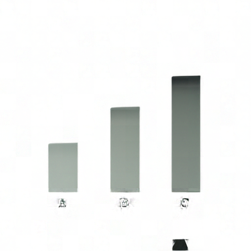
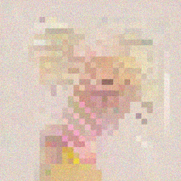

# Overgo

Overgo runs, trains, evaluates, and composes AI models in Go and CUDA. Its
browser workbench, command-line tools, and HTTP APIs share execution components
and an artifact store. Recipes bind models, tasks, and execution policy;
OvergoDB retains inputs, results, and lineage.

The goal is recursive self-improvement: measured outcomes improve model
capability and the process that develops it. An improvement is one a user sees
on the [scorecard](#measured-improvement). Operators set goals, budgets, and
stop conditions; agents propose changes; executable policy checks admission,
verification, and activation.

[Quick start](#quick-start) · [Capabilities](#capabilities) ·
[Measured improvement](#measured-improvement) · [Training](#training) ·
[Development](#development-and-verification) · [References](#references)

## Quick start

The runtime target is Windows amd64 with Go 1.26. GPU execution requires an
NVIDIA CUDA driver; bundled kernels target compute capability 8.9 or newer (see
[kernels](kernels/README.md)).

```powershell
.\overgo_gui.bat                          # build, start, open the workbench
.\overgo_gui.bat "D:\models\model.gguf"   # start on a supported GGUF model
.\overgo_gui.bat "" -training -model-builder
```

The launcher builds the server and the model-swap proxy and opens
[the workbench](http://localhost:8080/). The model picker switches the served
model live; Library registers local models or configures a hosted provider.
Flags after the model reach every served child, so enabled workspaces survive
model switches. Training and construction need their registered inputs and
recipes.

To serve one model directly:

```powershell
go run ./cmd/server -listen 127.0.0.1:8080 D:/models/model.gguf
```

The server binds to loopback by default; see [SECURITY.md](SECURITY.md) for
authentication and network settings.

## Capabilities

Available operations depend on the active model, recipe, backend, and
workspace. The [compatibility matrix](docs/COMPATIBILITY.md), the model catalog
(`go run ./cmd/validate -models -repo <store>`), and the
[training report](docs/TRAINING_COMPATIBILITY.md) record verification scope and
separate bounded smoke runs from broader claims.

| Area | Operations |
| --- | --- |
| Serving | Chat, generation, embeddings, reranking, sequence scoring, streaming, constrained output, prompt caching, live model switching |
| Media and structured data | Image and video generation, video editing, speech synthesis, transcription, vision QA, time series, tabular execution |
| Model lifecycle | GGUF and safetensors intake, Hugging Face integration, conversion, quantization, inspection, construction, adapters, composition |
| Training | Token prediction, DPO, GRPO, host and CUDA execution, Muon, checkpoint and resume |
| Evaluation | Benchmarks, reference comparisons, long-context and retrieval checks, ablations, quality, throughput, and memory measurements |
| Agents and workflows | Registered tools, typed workflows, authorization, receipts, schedules, peers, recovery |

The server embeds the workbench; no client build is needed. Native,
OpenAI-compatible, and Anthropic-compatible APIs share one server; the
[API manifest](docs/api_manifest.json) inventories commands, routes,
authentication, and document contracts.

## Architecture and state

Recipes declare architecture, tensors, components, and execution policy; shared
inference and training components execute them. Profiles cover dense,
mixture-of-experts, recurrent, hybrid, encoder, diffusion, and multimodal
programs. Pinned references are [llama.cpp](https://github.com/ggml-org/llama.cpp),
audio.cpp, and [Transformers](https://github.com/huggingface/transformers);
provenance and license records accompany ported capabilities.

OvergoDB retains artifacts, recipes, runs, measurements, decisions,
checkpoints, and active versions. Content identities bind results to their
inputs for reuse, comparison, resume, and rollback. Evaluation retains
responses and protocols, so a compatible run carries forward instead of
repeating.


[Editable SVG](docs/assets/overgo-platform-technical-architecture.svg) ·
[Figure definition](docs/assets/overgo_graphic.json)

## Measured improvement

`go run ./cmd/validate -scorecard` prints the user scorecard for every
activated model and task: time to first output, throughput, held-out quality,
failures, load time, peak device memory, and setup steps. Each value is read
from the store, or listed as a gap with its reason.

One improvement cycle (`go run ./cmd/loop -improve`) first runs the checks its
measurements depend on: each measurement's preflight, which names any measurement
whose prerequisites are missing, and the longer test runs, which stop the cycle
if one fails. It then runs the validations
the scorecard waits on (long-form guards, serving, media, training and projection
proofs, held-out benchmarks that replay their newest record), publishes the
scorecard, and files each decline and each open gap as a plan row. There is no
passed state: progress is each scorecard cell compared with its previous
measurement.

### Served models

Every model with an active recipe, as the record `scorecard-20261028T150740Z`
measured it: one measurement run on the reference PC (Ryzen 9 9950X, RTX 4090 D
with 48 GiB, Windows 11), every row served and scored on this machine. Modality
is the kind of data a model works in; input → output is what a request gives it
and what it answers. First output and throughput are the first request after a fresh load, so throughput
is a cold figure; the warm bench figures follow the table. Peak device memory
is the most the measured attempt held on the card; "host" marks a model that
runs on the CPU. The full scorecard, with failure rate, load time and setup
steps, is `go run ./cmd/validate -scorecard`; beyond these models, 138
architecture profiles are registered (`go run ./cmd/validate -models -repo <store>`).

| Model | Modality | Input → output | First output | Throughput | Held-out quality | Peak device memory |
| --- | --- | --- | --- | --- | --- | --- |
| Qwen3.8 Flash-Next (80B MoE, UD-IQ4_XS) | text, vision-language | text → text; image → text | 1.74 s; 2.84 s at a 4K prompt; 8.6 s at 16K | 67 tok/s | MMLU-Pro 0.66 on 1,209 cases; image questions 0.47 on 64 | 46.0 GiB |
| Qwen3.8-27B (Q6_K) | text, vision-language, video-language | text → text; image or video → text | 127 ms; 2.3 s at 4K; 9.8 s at 16K | 31 tok/s | MMLU-Pro 0.60; image and video questions 0.92 on 64 | 22.3 GiB |
| Qwen3.5-9B (Q8_0) | text | text → text | 39 ms; 0.79 s at 4K; 3.3 s at 16K | 97 tok/s | MMLU-Pro 0.49 | 9.0 GiB |
| Qwen3.5-4B | text | text → text | 143 ms; 0.42 s at 4K; 2.2 s at 16K | 97 tok/s | MMLU-Pro 0.49; 0.75 on 40 questions when left to think | 8.9 GiB |
| gemma-4-12B-it (fp8, native) | text | text → text | 168 ms; 1.1 s at 4K; 5.1 s at 16K | 51 tok/s | MMLU-Pro 0.49 | 14.3 GiB |
| gemma-4-12B-it (fp8 unpacked to bf16) | text | text → text | 195 ms; 1.3 s at 4K; 5.8 s at 16K | 37 tok/s | MMLU-Pro 0.49 | 22.2 GiB |
| gemma-4-E4B-it | text, vision-language, audio-language | text → text; audio or image → text | 152 ms; 0.59 s at 4K; 2.6 s at 16K | 76 tok/s | MMLU-Pro 0.44; 1.9% word error rate on 32 clips | 13.9 GiB |
| Bonsai-27B (Q1_0) | text | text → text | 109 ms; 2.2 s at 4K; 9.6 s at 16K | 56 tok/s | MMLU-Pro 0.42 | 4.2 GiB |
| MiniCPM5-1B | text | text → text | 113 ms; 0.22 s at 4K; 1.7 s at 16K | 372 tok/s | MMLU-Pro 0.30 | 2.0 GiB |
| Qwen2.5-0.5B (f16) | text | text → text | 117 ms; 0.23 s at 4K; 2.2 s at 16K | 524 tok/s | MMLU-Pro 0.17 | 0.9 GiB |
| Unlimited-OCR (bf16) | text | text → text | 128 ms; 0.27 s at 4K; 1.1 s at 16K | 446 tok/s | BBH 0.30, within noise of a constant answer | 5.5 GiB |
| Carbon-500M (f16) | genomic | DNA sequence → DNA sequence | 117 ms; 0.66 s at 4K | 509 tok/s | perplexity 910 on 128 sequences (a draft model; not what it is for) | 1.0 GiB |
| Fractale-350M-base | text | text → text, carrying notes between chunks | 4.9 s | 4.1 tok/s | carried gain 5.6 on 37 documents | host |
| needle | function calling | text → function call | 489 ms | 220 tok/s | 0.255 on 400 calls | host |
| Hy-Embodied-RxBrain-1.0 | vision-language | image + question → answer | 9.5 s | 181 tok/s | 0.63 on 64 questions (chance 0.25) | 3.5 GiB |
| Krea-2-Turbo | text-to-image | text → image | 13.9 s | — | 0.94 on 415 prompts | 25.0 GiB |
| SenseNova-U1-8B-MoT-Infographic-V3 | text-to-image | text → image (infographics) | 13.1 s | — | 100 of 100, the suite's ceiling | 15.4 GiB |
| SimpleDiffusion-TensorProductAttentionRope | image generation | noise → image, no caption | 0.84 s | — | no caption suite applies | 0.5 GiB |
| MOSS-Image-SFT | text-to-image | text → image | not yet measured | — | — | — |
| Un-0 | image generation, video generation | class → 8×8 picture or 12-frame clip (a 120 kB toy model) | 12 ms; 30 ms | — | no caption suite applies | host |
| Wan2.1-T2V 1.3B | text-to-video | text → video | 13.0 s | — | 0.91 on 128 clips | 3.6 GiB |
| LiveEdit | video editing | video + instruction → video | 9.6 s | — | 0.84 on 64 clips | 3.5 GiB |
| Wan2.1 VAE | video autoencoder | video frame → frame (reconstruction) | 1.4 s | — | 41.4 dB PSNR on 128 | 4.4 GiB |
| ViTXL_n08 | image autoencoder | image → image (reconstruction) | 8.0 s | — | 20.5 dB PSNR on 128 | host |
| webssl-dino300m-full2b-224 | image embedding | image → embedding | 4.5 s | — | retrieval 0.46 on 483 | host |
| webssl-dino-to-rae-bridge | image autoencoder | image → image through a fitted bridge | 10.8 s | — | 18.2 dB PSNR on 128 | host |
| granite-speech 470M | speech recognition | speech → text | 2.8 s | — | 0.9% word error rate on 32 clips | 1.0 GiB |
| nemotron-3.5-asr-streaming-0.6b | speech recognition | speech → text, streaming | 4.2 s | — | 3.1% word error rate on 32 clips | host |
| pocket-tts | speech synthesis | text → speech | 2.8 s | — | 2.2% word error rate, re-transcribed, on 64 texts | host |
| timesfm-2.5-200m | time series | numeric series → forecast | 0.66 s | — | mean absolute error 2.24 on 11 series | host |
| timesfm-3.0 | time series | numeric series → forecast | 0.92 s | — | mean absolute error 2.18 on 30 series | host |
| tabfm-1.0.0 | tabular | table → class | 2.6 s | — | 0.72 on 7 tables, within noise of a constant answer | host |

Training recipes with a completed proof on this machine: Qwen2.5-0.5B (token
accuracy 0.508 against its base 0.500 on 24 held-out cases), Qwen3.5-4B,
Qwen3.5-9B, Hy-Embodied-RxBrain, LiveEdit, Wan2.1, tabfm (0.729 against 0.724)
and the dino-to-RAE bridge; see the
[training report](docs/TRAINING_COMPATIBILITY.md).

Warm, served, against Strata's frozen bench suite on the same PC and model
(three alternating rounds each, 2026-10-24): Flash-Next decodes a short chat at
99 to 104 tok/s against Strata's 133 to 136, reads a 4K prompt to its first
token in 1.46 s against 2.2 s and a 16K prompt in 5.3 s against 5.0 s, and
decodes agent turns at 91 to 93 tok/s against 145 to 146; a conversation of
237,290 tokens is read in 2m16s with every later question answered in about
0.8 s. Strata's decode round was then ported (2026-10-27) and landed as it stood:
closing the remaining gap is no longer this campaign's target, by the owner's
decision of 2026-10-27, and a question that branches off an earlier turn of such
a conversation is answered from the context already read, in about 1.3 s.

### Sample outputs

Each sample is the output of the attempt the scorecard measures, exported from
the store into [assets](assets) by
`go run ./cmd/validate -export-samples -media-scope measured -repo <store>` and
named by the SHA-256 of its bytes, so it is checkable against the run that
produced it. The time is that attempt's whole request after a fresh load; the
memory is its peak on the card.

**Krea-2-Turbo, text → image.** "a red fox licking a vanilla ice cream cone in
snow", 512 × 512, 4 steps, seed 2026: 13.9 s, 25.1 GiB.


**SenseNova-U1-8B-MoT-Infographic-V3, text → image.** "a minimal infographic
of three rising bars labeled A B C", 512 × 512, 4 steps, guidance 4.5, seed
2026: 13.1 s, 15.5 GiB. A 1536 × 2720 infographic in 50 steps from the frozen
visual-review case:
[image](assets/5f3a56dff6b7a4a9e96d3d129082fdc349717357ff48d54454ff9535fb0cce68.png).



**SimpleDiffusion-TensorProductAttentionRope, noise → image.** 256 × 256 in 8
steps, seed 2026: 0.92 s, 0.6 GiB.



**Wan2.1-T2V 1.3B, text → video.** The measured request is a small one: "a red
fox licking a vanilla ice cream cone on a snowy pine forest trail", 21 frames
at 32 × 16, 2 steps: 13.0 s, 3.6 GiB
([clip](assets/e6e246d2f322356bf07a83e137a2c4341a97eed8dd45b3f188736ba92e248865.gif)).
The frozen visual-review case, 81 frames at 832 × 480 in 50 steps, took 6 min
14 s when it was drawn at commit fcda318af (2026-09-12); its device memory was
not recorded.


**LiveEdit, video + instruction → video.** 21 source frames at 32 × 16 through
four denoising steps, seed 7: 9.5 s, 3.5 GiB
([clip](assets/5b1c2046f691ac277efc9b08f4f6fe0f35225e021a82afc8006fedebad127d4b.gif)).

**pocket-tts, text → speech.** "Once upon a time, in a quiet valley, a small
fox learned to sing.", voice alba: 5.4 s of 24 kHz audio in 2.6 s on the host
([WAV](assets/e845e24c17cae1270136a1aac2feb680c79e81c842a243ef2e69def47db8bc4a.wav)).

**granite-speech 470M and nemotron, speech → text.** The same held-out
LibriSpeech clip. granite, 2.8 s and 1.1 GiB: "my 1st and principal reason was
that they enforced beyond all resistance on any student who might attempt to
copy them this method of laying portions of distinct hue side by side".
nemotron, 4.3 s on the host: "My first and principal reason was that they
enforced beyond all resistance on any student who might attempt to copy them
this method of laying portions of distinct hue side by side."

**Hy-Embodied-RxBrain-1.0, image + question → answer.** On the model's own
demonstration picture, "What objects are on the stovetop, and where is the
green toy?" → "The stovetop holds a metal pot on the left burner", the
request's 12-token budget, in 9.8 s and 3.5 GiB.

**Un-0, class → picture or clip.** Class 1, seed 2026: an 8 × 8
[picture](assets/1995cda0e2c6ed9fb394c00c7baa68b208b3d8a6a604923588289d1c5950b556.png)
in 12 ms and a 12-frame 16 × 16
[clip](assets/db326dae32fc3850abcf31985b0516513f3a59ca27276de82eccbb66806da36d.gif)
in 29 ms, on the host.

## Training

One Muon optimizer handles matrices, vectors, scalars, embeddings,
normalization parameters, and adapters. The recipe binds the
[optimizer policy](internal/trainingprogram/optimizer_policy.json); parameter
count $P$ determines its settings:

- **Learning rate:** $\eta=P^{-0.6}$ for a model that already learned,
  $P^{-0.5}$ for weights trained from initialization; constant schedule.
- **Momentum:** $\mu=(N-1)/(N+1)=29/31$ with $N=30$ effective samples, from the
  rule of thumb of Cochran's confidence-interval criterion.
- **Update scale:** $\eta\sqrt{\max(m,n)}\sqrt{1-\mu^2}$ per $m\times n$ group.

Muon combines gradients with momentum, normalizes the Nesterov direction, and
orthogonalizes by Newton–Schulz iteration; on CUDA its math stays on the
device and only scalars cross to the host. Optimizer state keeps the resolved
settings, update count, and momentum. Suitability is assessed per task through
training evidence.

`cmd/train` is the one entry point. A registered recipe trains a checkpoint;
`-objective <alias>` trains a text model on a registered objective's training
split and publishes the model and the held-out verdict that binds it; `-route
<trainer>` runs a bounded family trainer by name. A training recipe activates on
the verification its first successful run records.

```powershell
go run ./cmd/train -route oscillatorimage -model Un-0 -steps 2
```

See the [optimizer](internal/hostoptimizer/optimizer.go) and
[training compatibility](docs/TRAINING_COMPATIBILITY.md) for implementation and
recorded runs.

## Agent tools

A [tool manual](internal/agenttool/manual.go) declares a tool's arguments,
effect class, and transport: Go functions, HTTP endpoints, fixed programs
without a shell, MCP tools, sequenced JSON streams.
[cmd/agent-tool](cmd/agent-tool/main.go) publishes manuals to the store. The
[agent loop](internal/agentloop/coordinator.go) checks registration and
execution bounds; mutations need a completed inspection and exact approval and
record a durable receipt first. The serving executor refuses loopback, private,
and link-local destinations; the operator executor admits private ones.

## Development and verification

[skill.md](skill.md) holds the development principles; [docs/plan.json](docs/plan.json)
holds priorities, dependencies, owners, and acceptance.

1. Take the next row: `go run ./cmd/plan -next`.
2. Land it: `go run ./cmd/loop -land <item>/<step> -message-file -`. The
   [small gate](internal/landing/landing.go) (its package doc lists the stages)
   checks the tree and commits with the step removed from the plan.
3. The improvement cycle measures the scorecard and files each decline as a row.
4. Scorecard gaps become the next rows.

The gate judges a commit from the tree alone: unit, golden, hermetic, and
small-device checks. Real-model and live-store suites belong to the cycle.
Priorities are fewer components, facts classified once through existing owners,
and less repeated work; rules that matter are enforced by the gate. The
[loop driver](cmd/loop/main.go) supervises workers under configured limits and
operator stops.

Local feedback on affected packages:

```powershell
go run ./cmd/validate -tests ./internal/recipe
```

Device and browser checks use `cmd/device-lane` and `cmd/webui-lane`; installed
models are checked with `go run ./cmd/validate -smoke`.

## References

- [API manifest](docs/api_manifest.json) — commands, routes, typed contracts
- Benchmark report — `go run ./cmd/benchmark-report -repo <store>` prints evaluation and performance results
- Model catalog — `go run ./cmd/validate -models -repo <store>`
- Media report — `go run ./cmd/validate -media markdown -repo <store>` (`-media json` for the typed projection)
- [Training compatibility](docs/TRAINING_COMPATIBILITY.md) — training evidence and scope
- [Compatibility matrix](docs/COMPATIBILITY.md) — features and verification references
- [Development plan](docs/plan.json) — current work and completion checks
- [License](LICENSE) and [software bill of materials](SBOM.cdx.json)
