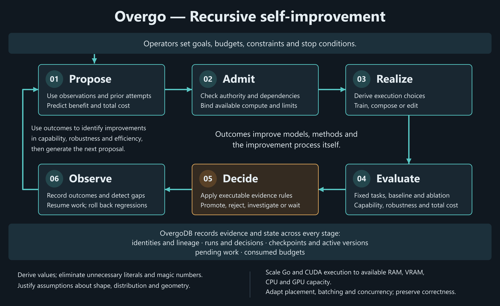

# Overgo

Overgo runs, trains, evaluates, and composes AI models in Go and CUDA. Its
browser workbench, command-line tools, and HTTP APIs share execution components
and an artifact store. Recipes bind models, tasks, and execution policy;
OvergoDB retains inputs, results, and lineage.

The goal is recursive self-improvement: measured outcomes improve model
capability and the process that develops it. An improvement is one a user sees
on the [scorecard](#measured-improvement). Operators set goals, budgets, and
stop conditions; agents propose changes; executable policy checks admission,
verification, and activation.

[Quick start](#quick-start) · [Capabilities](#capabilities) ·
[Measured improvement](#measured-improvement) · [Training](#training) ·
[Development](#development-and-verification) · [References](#references)

## Quick start

The runtime target is Windows amd64 with Go 1.26. GPU execution requires an
NVIDIA CUDA driver; bundled kernels target compute capability 8.9 or newer (see
[kernels](kernels/README.md)).

```powershell
.\overgo_gui.bat                          # build, start, open the workbench
.\overgo_gui.bat "D:\models\model.gguf"   # start on a supported GGUF model
.\overgo_gui.bat "" -training -model-builder
```

The launcher builds the server and the model-swap proxy and opens
[the workbench](http://localhost:8080/). The model picker switches the served
model live; Library registers local models or configures a hosted provider.
Flags after the model reach every served child, so enabled workspaces survive
model switches. Training and construction need their registered inputs and
recipes.

To serve one model directly:

```powershell
go run ./cmd/server -listen 127.0.0.1:8080 D:/models/model.gguf
```

The server binds to loopback by default; see [SECURITY.md](SECURITY.md) for
authentication and network settings.

## Capabilities

Available operations depend on the active model, recipe, backend, and
workspace. The [compatibility matrix](docs/COMPATIBILITY.md), the model catalog
(`go run ./cmd/validate -models -repo <store>`), and the
[training report](docs/TRAINING_COMPATIBILITY.md) record verification scope and
separate bounded smoke runs from broader claims.

| Area | Operations |
| --- | --- |
| Serving | Chat, generation, embeddings, reranking, sequence scoring, streaming, constrained output, prompt caching, live model switching |
| Media and structured data | Image and video generation, video editing, speech synthesis, transcription, vision QA, time series, tabular execution |
| Model lifecycle | GGUF and safetensors intake, Hugging Face integration, conversion, quantization, inspection, construction, adapters, composition |
| Training | Token prediction, DPO, GRPO, host and CUDA execution, Muon, checkpoint and resume |
| Evaluation | Benchmarks, reference comparisons, long-context and retrieval checks, ablations, quality, throughput, and memory measurements |
| Agents and workflows | Registered tools, typed workflows, authorization, receipts, schedules, peers, recovery |

The server embeds the workbench; no client build is needed. Native,
OpenAI-compatible, and Anthropic-compatible APIs share one server; the
[API manifest](docs/api_manifest.json) inventories commands, routes,
authentication, and document contracts.

## Architecture and state

Recipes declare architecture, tensors, components, and execution policy; shared
inference and training components execute them. Profiles cover dense,
mixture-of-experts, recurrent, hybrid, encoder, diffusion, and multimodal
programs. Pinned references are [llama.cpp](https://github.com/ggml-org/llama.cpp),
audio.cpp, and [Transformers](https://github.com/huggingface/transformers);
provenance and license records accompany ported capabilities.

OvergoDB retains artifacts, recipes, runs, measurements, decisions,
checkpoints, and active versions. Content identities bind results to their
inputs for reuse, comparison, resume, and rollback. Evaluation retains
responses and protocols, so a compatible run carries forward instead of
repeating.



[Editable SVG](docs/assets/overgo-platform-technical-architecture.svg) ·
[Figure definition](docs/assets/overgo_graphic.json)

## Measured improvement

`go run ./cmd/validate -scorecard` prints the user scorecard for every
activated model and task: time to first output, throughput, held-out quality,
failures, load time, peak device memory, and setup steps. Each value is read
from the store, or listed as a gap with its reason.

One improvement cycle (`go run ./cmd/loop -improve`) runs the validations
promotion waits on (long-form guards, serving, media, training and projection
proofs, held-out benchmarks that replay their newest record), publishes the
scorecard, and fast-forwards `main` only when held-out quality holds against
the scorecard `main` already has. Open gaps become plan rows. Progress is
counted in promotions, not landings.

## Training

One Muon optimizer handles matrices, vectors, scalars, embeddings,
normalization parameters, and adapters. The recipe binds the
[optimizer policy](internal/trainingprogram/optimizer_policy.json); parameter
count $P$ determines its settings:

- **Learning rate:** $\eta=P^{-0.6}$ for a model that already learned,
  $P^{-0.5}$ for weights trained from initialization; constant schedule.
- **Momentum:** $\mu=(N-1)/(N+1)=29/31$ with $N=30$ effective samples, from the
  rule of thumb of Cochran's confidence-interval criterion.
- **Update scale:** $\eta\sqrt{\max(m,n)}\sqrt{1-\mu^2}$ per $m\times n$ group.

Muon combines gradients with momentum, normalizes the Nesterov direction, and
orthogonalizes by Newton–Schulz iteration; on CUDA its math stays on the
device and only scalars cross to the host. Optimizer state keeps the resolved
settings, update count, and momentum. Suitability is assessed per task through
training evidence.

`cmd/train` is the one entry point. A registered recipe trains a checkpoint;
`-objective <alias>` trains a text model on a registered objective's training
split and publishes the model and the held-out verdict that binds it; `-route
<trainer>` runs a bounded family trainer by name. A training recipe activates on
the verification its first successful run records.

```powershell
go run ./cmd/train -route oscillatorimage -model Un-0 -steps 2
```

See the [optimizer](internal/hostoptimizer/optimizer.go) and
[training compatibility](docs/TRAINING_COMPATIBILITY.md) for implementation and
recorded runs.

## Agent tools

A [tool manual](internal/agenttool/manual.go) declares a tool's arguments,
effect class, and transport: Go functions, HTTP endpoints, fixed programs
without a shell, MCP tools, sequenced JSON streams.
[cmd/agent-tool](cmd/agent-tool/main.go) publishes manuals to the store. The
[agent loop](internal/agentloop/coordinator.go) checks registration and
execution bounds; mutations need a completed inspection and exact approval and
record a durable receipt first. The serving executor refuses loopback, private,
and link-local destinations; the operator executor admits private ones.

## Development and verification

[skill.md](skill.md) holds the development principles; [docs/plan.json](docs/plan.json)
holds priorities, dependencies, owners, and acceptance.

1. Take the next row: `go run ./cmd/plan -next`.
2. Land it: `go run ./cmd/loop -land <item>/<step> -message-file -`. The
   [small gate](internal/landing/landing.go) (its package doc lists the stages)
   checks the tree and commits with the step removed from the plan.
3. The improvement cycle judges models on held-out data and promotes `main`.
4. Scorecard gaps become the next rows.

The gate judges a commit from the tree alone: unit, golden, hermetic, and
small-device checks. Real-model and live-store suites belong to the cycle.
Priorities are fewer components, facts classified once through existing owners,
and less repeated work; rules that matter are enforced by the gate. The
[loop driver](cmd/loop/main.go) supervises workers under configured limits and
operator stops.

Local feedback on affected packages:

```powershell
go run ./cmd/validate -tests ./internal/recipe
```

Device and browser checks use `cmd/device-lane` and `cmd/webui-lane`; installed
models are checked with `go run ./cmd/validate -smoke`.

## References

- [API manifest](docs/api_manifest.json) — commands, routes, typed contracts
- [Benchmark report](docs/BENCHMARK.md) — evaluation and performance results
- Model catalog — `go run ./cmd/validate -models -repo <store>`
- Media report — `go run ./cmd/validate -media markdown -repo <store>` (`-media json` for the typed projection)
- [Training compatibility](docs/TRAINING_COMPATIBILITY.md) — training evidence and scope
- [Compatibility matrix](docs/COMPATIBILITY.md) — features and verification references
- [Development plan](docs/plan.json) — current work and completion checks
- [License](LICENSE) and [software bill of materials](SBOM.cdx.json)
