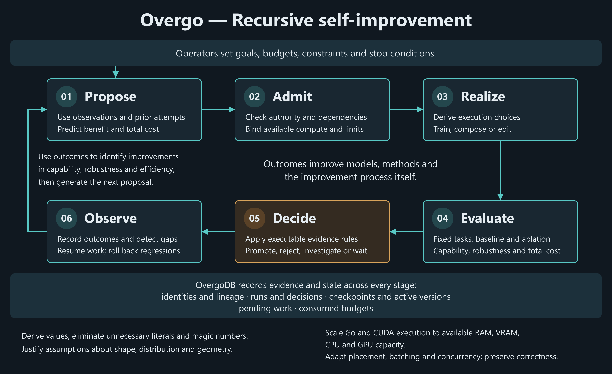
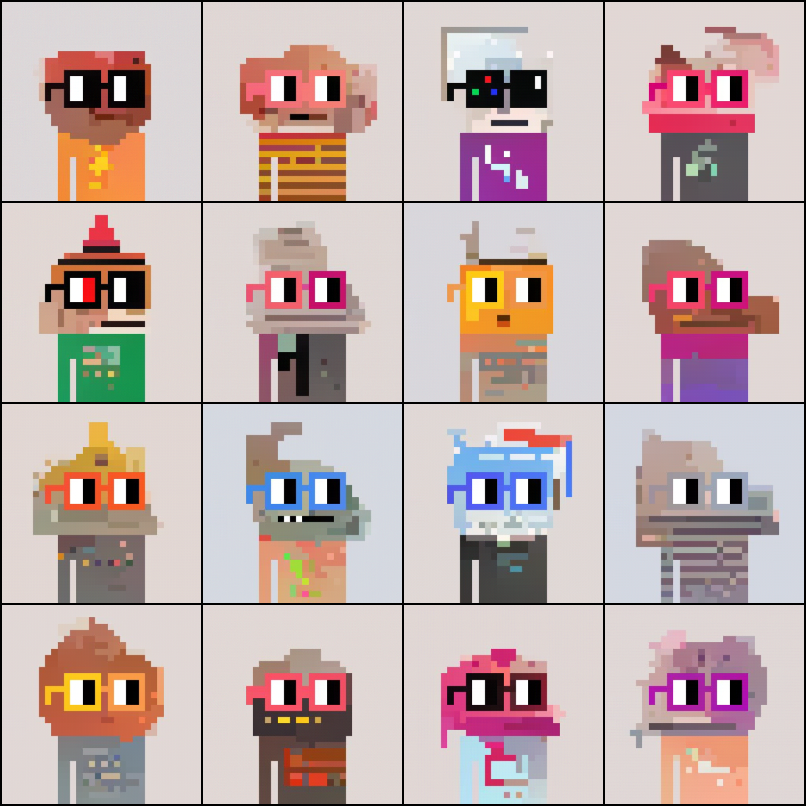
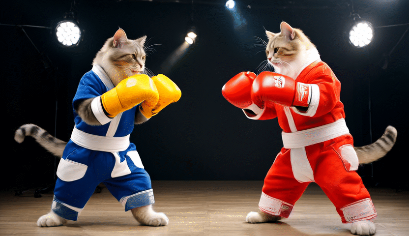
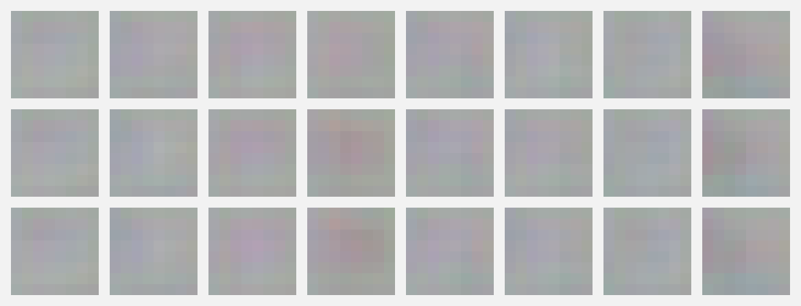

# Overgo

Overgo runs, trains, evaluates, and composes AI models in Go and CUDA. Its
browser workbench, command-line tools, and HTTP APIs share execution components
and an artifact store. Recipes bind models, tasks, and execution policy;
OvergoDB retains inputs, results, and lineage.

The goal is recursive self-improvement: measured outcomes improve model
capability and the process that develops it. An improvement is one a user sees
on the [scorecard](#measured-improvement). Operators set goals, budgets, and
stop conditions; agents propose changes; executable policy checks admission,
verification, and activation.

[Quick start](#quick-start) · [Capabilities](#capabilities) ·
[Measured improvement](#measured-improvement) · [Training](#training) ·
[Development](#development-and-verification) · [References](#references)

## Quick start

The runtime target is Windows amd64 with Go 1.26. GPU execution requires an
NVIDIA CUDA driver; bundled kernels target compute capability 8.9 or newer (see
[kernels](kernels/README.md)).

```powershell
.\overgo_gui.bat                          # build, start, open the workbench
.\overgo_gui.bat "D:\models\model.gguf"   # start on a supported GGUF model
.\overgo_gui.bat "" -training -model-builder
```

The launcher builds the server and the model-swap proxy and opens
[the workbench](http://localhost:8080/). The model picker switches the served
model live; Library registers local models or configures a hosted provider.
Flags after the model reach every served child, so enabled workspaces survive
model switches. Conversation fine-tuning and `cmd/train` routes need no recipe;
other training and construction need their registered inputs and recipes.

To serve one model directly:

```powershell
go run ./cmd/server -listen 127.0.0.1:8080 D:/models/model.gguf
```

A model runs from its own files whether or not anything has verified it: the
prototype its architecture selects, sized by its metadata or `config.json`, and
the template and sampling they declare. The catalog, each response and each
attempt's record say whether it is verified. Directories run for the `llama`,
`qwen2` and `qwen3_5` model types; other architectures run from a GGUF file.

The server binds to loopback by default; see [SECURITY.md](SECURITY.md) for
authentication and network settings.

## Capabilities

Available operations depend on the active model, recipe, backend, and
workspace. The [compatibility matrix](docs/COMPATIBILITY.md), the model catalog
(`go run ./cmd/validate -models -repo <store>`), and the
[training report](docs/TRAINING_COMPATIBILITY.md) record verification scope and
separate bounded smoke runs from broader claims.

| Area | Operations |
| --- | --- |
| Serving | Chat, generation, embeddings, reranking, sequence scoring, streaming, constrained output, prompt caching, live model switching |
| Media and structured data | Image and video generation, video editing, speech synthesis, transcription, vision QA, time series, tabular execution |
| Model lifecycle | GGUF and safetensors intake, Hugging Face integration, conversion, quantization, inspection, construction, adapters, composition |
| Training | Token prediction, DPO, GRPO, host and CUDA execution, Muon, checkpoint and resume |
| Evaluation | Benchmarks, reference comparisons, long-context and retrieval checks, ablations, quality, throughput, and memory measurements |
| Agents and workflows | Registered tools, typed workflows, authorization, receipts, schedules, peers, recovery |

The server embeds the workbench; no client build is needed. Native,
OpenAI-compatible, and Anthropic-compatible APIs share one server; the
[API manifest](docs/api_manifest.json) inventories commands, routes,
authentication, and document contracts.

## Architecture and state

Recipes declare architecture, tensors, components, and execution policy; shared
inference and training components execute them. Profiles cover dense,
mixture-of-experts, recurrent, hybrid, encoder, diffusion, and multimodal
programs. Pinned references are [llama.cpp](https://github.com/ggml-org/llama.cpp),
audio.cpp, and [Transformers](https://github.com/huggingface/transformers);
provenance and license records accompany ported capabilities.

OvergoDB retains artifacts, recipes, runs, measurements, decisions,
checkpoints, and active versions. Content identities bind results to their
inputs for reuse, comparison, resume, and rollback. Evaluation retains
responses and protocols, so a compatible run carries forward instead of
repeating.



[Editable SVG](docs/assets/overgo-platform-technical-architecture.svg) ·
[Figure definition](docs/assets/overgo_graphic.json)

## Measured improvement

`go run ./cmd/validate -scorecard` prints the user scorecard for every
activated model and task: time to first output, throughput, held-out quality,
failures, load time, peak device memory, and setup steps. Each value is read
from the store, or listed as a gap with its reason.

One improvement cycle (`go run ./cmd/loop -improve`) first runs the checks its
measurements depend on: each measurement's preflight, which names any measurement
whose prerequisites are missing, and the longer test runs, which stop the cycle
if one fails. It then runs the validations
the scorecard waits on (long-form guards, serving, media, training and projection
proofs, held-out benchmarks that replay their newest record), publishes the
scorecard, and files each decline and each open gap as a plan row. There is no
passed state: progress is each scorecard cell compared with its previous
measurement.

### Served models

Every model with an active recipe, as the newest scorecard record measured it:
one measurement run on the reference PC (Ryzen 9 9950X, RTX 4090 D with 48 GiB,
Windows 11), every row served and scored on this machine. Modality is the kind
of data a model works in; input → output is what a request gives it and what it
answers. Held-out quality is each reading the scorecard shows first for one of
the model's tasks, with its standard error, the cases it rests on, the answers
it counted wrong because they named no option, and where it does not clear what
a constant answer scores. Peak device memory is the most a measured attempt
held on the card; "host" marks a model that runs on the CPU, and — a cell this
record did not measure, whose reason the scorecard gives. Speed is reported
warm and follows the table. The full scorecard, with failure rate, load time and
setup steps, is `go run ./cmd/validate -scorecard`; beyond these models, 138
architecture profiles are registered (`go run ./cmd/validate -models -repo <store>`).

<!-- served-model table: go run ./cmd/validate -readme writes it from the newest scorecard record -->
Read from the record `scorecard-20261125T170629Z`.

| Model | Modality | Input → output | Held-out quality | Peak device memory |
| --- | --- | --- | --- | --- |
| Qwen3.8 Flash-Next (80B MoE, UD-IQ4_XS) | text, vision-language | text → text; image → text | MMLU-Pro 0.682 ±0.013 on 1,209 cases; image questions 0.469 ±0.062 on 64 cases | 46.4 GiB |
| Qwen3.8-27B (Q6_K) | text, vision-language, video-language | text → text; image or video → text | MMLU-Pro 0.595 ±0.014 on 1,209 cases, 5 named no option (5 ran out of the answer's tokens), 257 of them development evidence; image questions 0.484 ±0.031 on 256 cases | 25.4 GiB |
| Qwen3.5-9B (Q8_0) | text | text → text | BBH 0.624 ±0.02 on 577 cases | 11.6 GiB |
| Qwen3.5-4B | text | text → text | MMLU-Pro 0.501 ±0.014 on 1,209 cases | 10.3 GiB |
| gemma-4-12B-it (fp8, its own files) | text | text → text | — | 18.2 GiB |
| gemma-4-12B-it (bf16, its published files) | text, vision-language | text → text; image → text | — | 26.3 GiB |
| gemma-4-E4B-it | text, vision-language, audio-language | text → text; audio or image → text | MMLU-Pro 0.413 ±0.014 on 1,209 cases; word error rate 0.0191 ±0.005 on 32 cases | 19.6 GiB |
| Bonsai-27B (Q1_0) | text | text → text | MMLU-Pro 0.393 ±0.014 on 1,209 cases | 8.5 GiB |
| MiniCPM5-1B | text | text → text | MMLU-Pro 0.285 ±0.013 on 1,209 cases | 3.5 GiB |
| Qwen2.5-0.5B (f16) | text | text → text | MMLU-Pro 0.182 ±0.011 on 1,209 cases | 2.0 GiB |
| qwen25-05b-judged-proof (trained from Qwen2.5-0.5B) | text | text → text | BBH 0.326 ±0.02 on 577 cases, within its noise of a constant answer | 2.9 GiB |
| qwen25-05b-order-25 (trained from Qwen2.5-0.5B) | text | text → text | BBH 0.303 ±0.019 on 577 cases, within its noise of a constant answer | 2.9 GiB |
| Unlimited-OCR (bf16) | text, vision-language | text → text; image → text, row by row | BBH 0.3 ±0.019 on 577 cases, within its noise of a constant answer | 8.9 GiB |
| Carbon-500M (f16) | genomic | DNA sequence → DNA sequence | DNA perplexity 910 on 128 cases | 1.7 GiB |
| Fractale-350M-base | text | text → text, carrying notes between chunks | carried gain (WikiText-2) 5.64 on 37 cases | host |
| needle | function calling | text → function call | BFCL simple calls 0.255 ±0.022 on 400 cases | host |
| Hy-Embodied-RxBrain-1.0 | vision-language | image + question → answer | image questions 0.625 ±0.061 on 64 cases, not a measure of what the model is for | 3.5 GiB |
| Krea-2-Turbo | text-to-image | text → image | questions about the drawn picture 0.94 ±0.012 on 415 cases | 31.3 GiB |
| SenseNova-U1-8B-MoT-Infographic-V3 | text-to-image | text → image (infographics) | drawn text 1 on 100 cases | 31.9 GiB |
| SimpleDiffusion-TensorProductAttentionRope | image generation | noise → image, no caption | no held-out measure applies | 0.6 GiB |
| MOSS-Image-SFT | text-to-image | text → image; [trains adapters](docs/MOSS_IMAGE.md) | questions about the drawn picture 0.922 ±0.012 on 524 cases | 14.0 GiB |
| Un-0 | image generation, video generation | class → 8×8 picture or 12-frame clip (a 120 kB toy model) | no held-out measure applies | host |
| Wan2.1-T2V 1.3B | text-to-video | text → video | questions about the caption 0.914 ±0.025 on 128 cases | 18.1 GiB |
| Self-Forcing (Wan2.1-T2V 1.3B, distilled) | text-to-video | text → video | questions about the caption 0.814 ±0.025 on 237 cases | 29.1 GiB |
| LiveEdit | video editing | video + instruction → video | questions about the edit 0.844 ±0.045 on 64 cases | 12.2 GiB |
| Wan2.1 VAE | video autoencoder | video frame → frame (reconstruction) | PSNR (dB, 480 × 832) 41.4 on 128 cases | 2.8 GiB |
| ViTXL_n08 | image autoencoder | image → image (reconstruction) | PSNR (dB, 256 × 256) 20.5 on 128 cases | host |
| webssl-dino300m-full2b-224 | image embedding | image → embedding | scene retrieval 0.458 ±0.023 on 483 cases | host |
| webssl-dino-to-rae-bridge | image autoencoder | image → image through a fitted bridge | PSNR (dB, 256 × 256) 18.2 on 128 cases | host |
| granite-speech 470M | speech recognition | speech → text | word error rate 0.00889 ±0.0035 on 32 cases | 1.0 GiB |
| nemotron-3.5-asr-streaming-0.6b | speech recognition | speech → text, streaming | word error rate 0.0305 ±0.0092 on 32 cases | host |
| pocket-tts | speech synthesis | text → speech | word error rate (re-transcribed) 0.0216 on 64 cases | host |
| timesfm-2.5-200m | time series | numeric series → forecast | mean absolute error 2.24 ±0.22 on 11 cases | host |
| timesfm-3.0 | time series | numeric series → forecast | mean absolute error 2.18 on 30 cases | host |
| tabfm-1.0.0 | tabular | table → class | table accuracy 0.724 ±0.023 on 7 cases, within its noise of a constant answer | host |
<!-- end of the served-model table -->

<!-- training line: go run ./cmd/validate -readme writes it from the training specifications and the newest scorecard record -->
Training, by the strongest tier of each recipe's evidence in the [training report](docs/TRAINING_COMPATIBILITY.md): `capability-measured`, a held-out measure of what training changed, for MOSS-Image-SFT; `real-artifact-smoke`, a bounded run on the real model, of 1 to 200 steps, which shows the route runs and not that training converges, for Bonsai-27B-Q1, Carbon-500M, Fractale-350M, gemma-4-12B-it-fp8, gemma-4-E4B-it-bf16-GGUF, Hy-Embodied-RxBrain-1.0, Krea-2-Turbo, LiveEdit, Needle-seq2seq, Pocket-TTS, Qwen3.5-4B, Qwen3.5-9B-Q8, SenseNova-U1-8B-MoT, SimpleDiffusion-TPA-Rope, TabFM-1.0-classification, TabFM-1.0-regression, TimesFM-2.5-200M, Un-0, Unlimited-OCR, Wan2.1-T2V-1.3B. Held-out verdicts in the record: Qwen2.5-0.5B, token accuracy 0.517 ±0.0078 against its base's 0.5 on 24 cases; tabfm-1.0.0-pytorch, table accuracy 0.729 ±0.021 against its base's 0.724 on 7 cases, within its noise of a constant answer.
<!-- end of the training line -->

### Speed

Prompt processing (pp) is a fresh prompt's tokens over the time to its first
token, read on a model already loaded after one unmeasured prompt of that size,
so it includes each request's fixed costs; token generation (tg) is generated
tokens over decode time on a request again on the loaded model.

<!-- speed table: go run ./cmd/validate -readme writes it from the newest scorecard record -->
| Model | pp, about 4,096 tokens | pp, about 16,384 tokens | tg |
| --- | --- | --- | --- |
| Bonsai-27B-Q1_0 | 1,951 tok/s, 4,096 tokens in 2.10 s | 1,597 tok/s, 16,384 tokens in 10.26 s | 58 tok/s |
| Carbon-500M | 58,215 tok/s, 4,096 tokens in 0.07 s | — | 498 tok/s |
| MiniCPM5-1B | 40,103 tok/s, 4,097 tokens in 0.10 s | 18,499 tok/s, 16,385 tokens in 0.89 s | 350 tok/s |
| Qwen2.5-0.5B | 64,366 tok/s, 4,096 tokens in 0.06 s | 36,356 tok/s, 16,384 tokens in 0.45 s | 527 tok/s |
| Qwen3.5-4B | 10,426 tok/s, 4,096 tokens in 0.39 s | 6,093 tok/s, 16,384 tokens in 2.69 s | 99 tok/s |
| Qwen3.5-9B | 5,854 tok/s, 4,096 tokens in 0.70 s | 4,310 tok/s, 16,384 tokens in 3.80 s | 98 tok/s |
| Qwen3.8 Flash Next | 2,952 tok/s, 4,096 tokens in 1.39 s | 3,489 tok/s, 16,384 tokens in 4.70 s | 170 tok/s |
| Qwen3.8-27B | 1,937 tok/s, 4,096 tokens in 2.11 s | 1,578 tok/s, 16,384 tokens in 10.38 s | 49 tok/s |
| Unlimited-OCR-bf16 | 23,171 tok/s, 4,096 tokens in 0.18 s | 18,733 tok/s, 16,385 tokens in 0.87 s | 454 tok/s |
| gemma-4-12B-it | 3,110 tok/s, 4,097 tokens in 1.32 s | 2,780 tok/s, 16,385 tokens in 5.89 s | 36 tok/s |
| gemma-4-12B-it-fp8 | 3,637 tok/s, 4,097 tokens in 1.13 s | 3,180 tok/s, 16,385 tokens in 5.15 s | 49 tok/s |
| gemma-4-E4B-it | 9,040 tok/s, 4,097 tokens in 0.45 s | 7,496 tok/s, 16,385 tokens in 2.19 s | 68 tok/s |
| qwen25-05b-judged-proof | 36,198 tok/s, 4,096 tokens in 0.11 s | 25,247 tok/s, 16,384 tokens in 0.65 s | 326 tok/s |
| qwen25-05b-order-25 | 36,308 tok/s, 4,096 tokens in 0.11 s | 25,258 tok/s, 16,384 tokens in 0.65 s | 331 tok/s |

| Model | time at the size a person asks for | time of the scorecard's timing request | where the person's request went |
| --- | --- | --- | --- |
| Krea-2-Turbo | 62.6 s (2048 x 2048, 8 steps, flow Euler, shift 3.158) | 14.3 s (512 x 512, 4 steps, flow Euler, shift 3.158) | picture prompt encoded 11.3 s, picture denoised 48.0 s |
| LiveEdit | — | 11.2 s (32 x 16, 21 frames, 4 steps, chunk-causal flow) | — |
| MOSS-Image-SFT-797fa8e678b4f | 58.4 s (1024 x 1024, 50 steps, flow Euler, guidance 3, shift 5) | 59.8 s (1024 x 1024, 50 steps, flow Euler, guidance 3, shift 5) | picture prompt encoded 5.8 s, picture denoised 51.4 s |
| Self-Forcing | 30.1 s (832 x 480, 81 frames, 4 steps, chunk-causal flow, guidance 1, shift 5) | 30.0 s (832 x 480, 81 frames, 4 steps, chunk-causal flow, guidance 1, shift 5) | model session leased 3.6 s, text encoder run 5.1 s, denoising pass 11.3 s, clip decoded 8.0 s |
| SenseNova-U1-8B-MoT-Infographic-V3 | 130.7 s (2048 x 2048, 50 steps, flow Euler, guidance 4.5, shift 3) | 12.3 s (512 x 512, 4 steps, flow Euler, guidance 4.5, shift 3) | model session leased 10.9 s, model.routed-image-integrate 120.0 s |
| SimpleDiffusion-TensorProductAttentionRope | — | 0.8 s (256 x 256, 8 steps, Euler) | — |
| Un-0 | — | 0.0 s (8 x 8, 4 steps, Kuramoto Euler) | — |
| Un-0 | 0.0 s (16 x 16, 8 frames, 4 steps, Kuramoto Euler) | 0.1 s (16 x 16, 12 frames, 4 steps, Kuramoto Euler) | model.oscillator-video-decode 0.0 s, (no part names) 0.0 s |
| Wan2.1-T2V-1.3B | 336.8 s (832 x 480, 81 frames, 50 steps, flow UniPC, guidance 6, shift 5) | 6.7 s (32 x 16, 21 frames, 2 steps, flow UniPC, guidance 6, shift 5) | clip denoised 320.7 s |
<!-- end of the speed table -->

Strata, on the same PC and model, processes Flash-Next's 4,096-token prompt at
1,850 tok/s and its 16,384-token prompt at 3,290 tok/s, and generates 135 tok/s
on its own bench's short chat and 145 tok/s on agent turns. A conversation of 237,290
tokens is read in 2m16s, every later question answered in about 0.8 s, and a
question that branches off an earlier turn of such a conversation is answered
from the context already read, in about 1.3 s.

### Sample outputs

Each sample is named by the SHA-256 of its bytes, so it is checkable against
the run that produced it. A timing request is an output of the attempts the
scorecard reads, exported from the store into [assets](assets) by
`go run ./cmd/validate -export-samples -media-scope measured -repo <store>`; its
time and memory are in the tables above, written from the scorecard. A sample
drawn at its developer's recommended settings says so, with its whole request,
and was drawn by `go run ./cmd/recipe run -fresh` on the date and commit it
names, in the time it gives.

**Krea-2-Turbo, text → image.** "a red fox licking a vanilla ice cream cone in
snow", 512 × 512, 4 steps, seed 2026.


**MOSS-Image-SFT, text → image.** "A small red sailboat on a quiet lake at
sunrise.", 1024 × 1024, 50 steps, guidance 3, seed 42.


**SenseNova-U1-8B-MoT-Infographic-V3, text → image.** At the model card's
settings for infographics: 'An infographic titled "How Solar Power Reaches
Your Home": four numbered steps left to right, each a flat icon with a short
label: 1 Sunlight hits the solar panels, 2 Cells turn light into DC
electricity, 3 An inverter changes DC to AC, 4 Power flows to the home and the
grid. Below, three key facts in rounded boxes: "Panels last 25+ years", "Zero
emissions while running", "Excess power goes back to the grid". Clean layout,
blue and orange palette, white background.', 2048 × 2048, 50 steps, guidance
4.0, timestep shift 3.0, seed 2026, drawn on 2026-11-24 at 7c6bef92f through
`go run ./cmd/recipe run -fresh` in 2 min 34 s. The scorecard's timing
request is "a minimal infographic of three rising bars labeled A B C" at
512 × 512 in 4 steps, guidance 4.5, seed 2026
([picture](assets/2ff397c2af4142c28e0de7b09e510422e2bcd6a09731f3659d76055bb8d3e9fd.png)).
A 1536 × 2720 infographic in 50 steps from the frozen visual-review case:
[image](assets/5f3a56dff6b7a4a9e96d3d129082fdc349717357ff48d54454ff9535fb0cce68.png).


**SimpleDiffusion-TensorProductAttentionRope, noise → image.** At its author's
settings, as the training script's sample() draws them, sixteen 256 × 256
pictures at once in 50 steps, `{"seed": 2026, "steps": 50, "height": 256,
"width": 256, "batch": 16, "sheet": true}`, laid out four to a row as the
author saves them, drawn on 2026-11-12 at 1ad2eb382 with this sample's change
in 37 s. Each agrees with the author's sampler from the same noise at 49 to
53 dB. The model mixes the pictures of a batch in its transformer blocks and
was trained on batches of 16 to 128, so a picture drawn alone comes out pale
and noisy. The author's saved sheets look darker because its script writes the
model's -1 to 1 range straight to a picture that clips below 0; this sheet maps
the range as the model was trained. The scorecard's timing request is one
picture drawn alone in 8 steps at seed 2026
([picture](assets/cd3f5feb951d9413f07060683035b12baaa909f67dead4b698c0fac24a629220.png)).



**Wan2.1-T2V 1.3B, text → video.** At the model card's settings (its
`model-card` preset): "A golden retriever runs along a beach at sunset,
splashing through shallow waves, sea spray glittering in the warm light, the
camera tracking alongside it.", 81 frames at 832 × 480, 50 steps, guidance 6,
shift 8, seed 2026, drawn on 2026-11-24 at 7c6bef92f through
`go run ./cmd/recipe run -fresh` in 6 min 11 s. It is not yet compared with a
ComfyUI recording of the same request.


**Self-Forcing (Wan2.1-T2V 1.3B, distilled), text → video.** At its
developers' settings, with Wan's own model-card example prompt, "Two
anthropomorphic cats in comfy boxing gear and bright gloves fight intensely on
a spotlighted stage.", and seed 2026: 81 frames at 832 × 480, 4 steps, chunk-causal flow, guidance 1,
shift 5, seed 2026, drawn on 2026-11-13 at eb197def6 in 36 s. The scorecard's
timing request has the same settings.



**LiveEdit, video + instruction → video.** The first 33 frames of the Wan clip
above, at 832 × 480, the size the editor was trained at, with the instruction
"Change the dark blue collar to a red collar.": four denoising steps of
chunk-causal flow, seed 7, drawn on 2026-11-25 at c21345fd7 in 25 s. The source
is on the left and the edit on the right. The editor makes the change and more:
the collar turns red and a red coat comes with it, as the model's own code does
when told to recolour one thing (TestServedEditMatchesTheModelsOwnEdit). Told
instead to make it snow, to make it night or to turn it into a cartoon, it gave
the clip back nearly as it was.


**pocket-tts, text → speech.** "Once upon a time, in a quiet valley, a small
fox learned to sing.", voice alba: 5.4 s of 24 kHz audio in 2.6 s on the host
([WAV](assets/e845e24c17cae1270136a1aac2feb680c79e81c842a243ef2e69def47db8bc4a.wav)).

**granite-speech 470M and nemotron, speech → text.** The same held-out
LibriSpeech clip. granite, 2.8 s: "my 1st and principal reason was
that they enforced beyond all resistance on any student who might attempt to
copy them this method of laying portions of distinct hue side by side".
nemotron, 4.3 s on the host: "My first and principal reason was that they
enforced beyond all resistance on any student who might attempt to copy them
this method of laying portions of distinct hue side by side."

**Hy-Embodied-RxBrain-1.0, image + question → answer.** On the model's own
demonstration picture, "What objects are on the stovetop, and where is the
green toy?" → "The stovetop holds a metal pot on the left burner", the
request's 12-token budget, in 9.8 s.

**Un-0, class → picture or clip.** A 120 kB toy model of 8 × 8 pictures:
its three classes (a row each) by seeds 1 to 8 (a column each), each picture
drawn through `go run ./cmd/recipe run -fresh` on 2026-11-24 at 7c6bef92f and
scaled 16 times by whole pixels into one card, so each of its pixels stays
square.



## Training

One Muon optimizer handles matrices, vectors, scalars, embeddings,
normalization parameters, and adapters. The recipe binds the
[optimizer policy](internal/trainingprogram/optimizer_policy.json); the count
$P$ of parameters in the run's plan, a frozen embedding table among them,
determines its settings:

- **Learning rate:** $\eta=P^{-0.6}$, constant, for a model that already
  learned; $P^{-0.5}$, decaying linearly, for weights trained from
  initialization.
- **Momentum:** $\mu=(N-1)/(N+1)=29/31$ with $N=30$ effective samples, from the
  rule of thumb of Cochran's confidence-interval criterion.
- **Update scale:** $\eta\sqrt{\max(m,n)}\sqrt{1-\mu^2}$ per $m\times n$ group.

Muon combines gradients with momentum, normalizes the Nesterov direction, and
orthogonalizes by Newton–Schulz iteration. On CUDA a resident trainer's math
stays on the device and only scalars cross to the host, and a flat or streamed
step copies its weights to the device and back. Optimizer state keeps the resolved
settings, update count, and momentum. Suitability is assessed per task through
training evidence.

`cmd/train` is the one entry point. A registered recipe trains a checkpoint;
`-objective <alias>` trains a text model on a registered objective's training
split and publishes the model and the held-out verdict that binds it; `-route
<trainer>` runs a bounded family trainer by name. A training recipe activates on
the verification its first successful run records.

```powershell
go run ./cmd/train -route oscillatorimage -model Un-0 -steps 2
```

See the [optimizer](internal/hostoptimizer/optimizer.go) and
[training compatibility](docs/TRAINING_COMPATIBILITY.md) for implementation and
recorded runs.

## Agent tools

A [tool manual](internal/agenttool/manual.go) declares a tool's arguments,
effect class, and transport: Go functions, HTTP endpoints, fixed programs
without a shell, which receive only the variables their manual names over a
small base, MCP tools, sequenced JSON streams.
[cmd/agent-tool](cmd/agent-tool/main.go) publishes manuals to the store. The
[agent loop](internal/agentloop/coordinator.go) checks registration and
execution bounds; mutations need a completed inspection and exact approval and
record a durable receipt first. The serving executor refuses every destination
[outside public unicast](internal/agenttool/security.go), the list the media
fetcher uses: loopback, private, link-local, multicast, carrier-grade NAT,
documentation and reserved ranges. The operator executor admits them.

## Development and verification

[skill.md](skill.md) holds the development principles; [docs/plan.json](docs/plan.json)
holds priorities, dependencies, owners, and acceptance.

1. Take the next row: `go run ./cmd/plan -next`.
2. Land it: `go run ./cmd/loop -land <item>/<step>`. The
   [small gate](internal/landing/landing.go) (its package doc lists the stages)
   checks the tree, writes the message and commits with the step removed from the plan.
3. The improvement cycle measures the scorecard and files each decline as a row.
4. Scorecard gaps become the next rows.

The gate judges a commit from the tree alone: unit, golden, hermetic, and
small-device checks. Real-model and live-store suites belong to the cycle.
Priorities are fewer components, facts classified once through existing owners,
and less repeated work; rules that matter are enforced by the gate. The
[loop driver](cmd/loop/main.go) supervises workers under configured limits and
operator stops.

Local feedback on affected packages:

```powershell
go run ./cmd/validate -tests ./internal/recipe
```

Device and browser checks use `cmd/device-lane` and `cmd/webui-lane`; installed
models are checked with `go run ./cmd/validate -smoke`.

## References

- [API manifest](docs/api_manifest.json) — commands, routes, typed contracts
- Benchmark report — `go run ./cmd/benchmark-report -repo <store>` prints evaluation and performance results
- Model catalog — `go run ./cmd/validate -models -repo <store>`
- Media report — `go run ./cmd/validate -media markdown -repo <store>` (`-media json` for the typed projection)
- [Training compatibility](docs/TRAINING_COMPATIBILITY.md) — training evidence and scope
- [Compatibility matrix](docs/COMPATIBILITY.md) — features and verification references
- [Development plan](docs/plan.json) — current work and completion checks
- [License](LICENSE) and [software bill of materials](SBOM.cdx.json)
